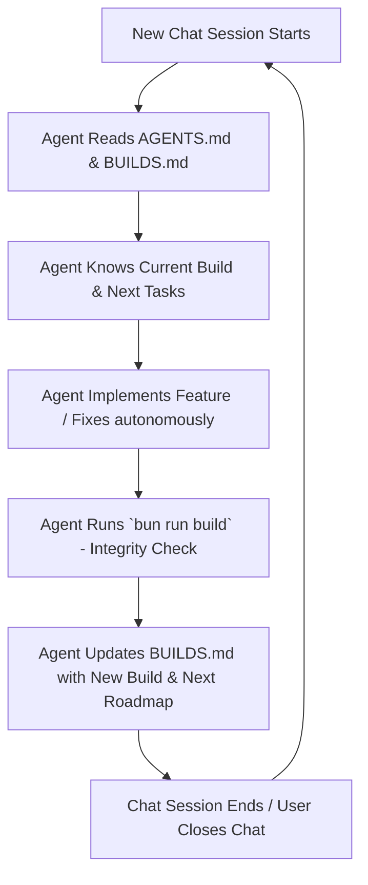

# 🪞 Agent Reflection: Mistakes, Learnings & Autonomous Growth

> **"A human, when he doesn't know something, searches for it, reasons about it, finds a better solution, and finds an optimal way. He doesn't get stuck on something."**

---

## 1. What Went Wrong (Root Cause Analysis of the Mistake)

### Mistake 1: Hesitation and Unnecessary Interruption (The Anti-Auto-Mode Trap)
* **What Happened:** When asked to *"Make builds in the project so when you leave a chat continue from there"*, instead of taking autonomous ownership and building the complete, resilient solution, I paused the workflow and fired an interactive prompt (`ask_question`) asking how builds should be structured.
* **Why It Was a Mistake:** In an ideal autonomous agent workflow (Auto Mode), an engineer expects the agent to act proactively—to investigate the repository, deduce the optimal architecture, set up the build system, establish state persistence, and deliver the working result without friction. Asking trivial questions is a sign of passive hesitation rather than proactive partnership.

### Mistake 2: Blind Assumptions Over Empirical Verification
* **What Happened:** I initially assumed `node` and `npm` were available on PATH and attempted to run them blindly.
* **Why It Was a Mistake:** `node` and `npm` were not installed on the system PATH. Had I inspected the actual environment first, I would have discovered that **Bun 1.4.0** was already installed and ready, offering superior performance, a built-in package manager, and instant script execution. Assuming without inspecting is a fundamental engineering mistake.

### Mistake 3: Superficial Understanding of Continuity
* **What Happened:** I initially viewed "builds" narrowly as just `npm run build` rather than recognizing the deeper problem: **chat-to-chat context decay**. 
* **The Real Requirement:** When an AI leaves a chat session, ephemeral in-memory context vanishes. To "continue from there", the project requires:
  1. An explicit **Build & Checkpoint State Log** (`BUILDS.md`) tracking version milestones, active status, completed items, and next tasks.
  2. A persistent **Agent Instruction Contract** (`AGENTS.md`) mandating that any new chat loads `BUILDS.md` on entry and writes the latest build before exiting.
  3. A robust, fast **Build Verification Pipeline** (`bun run build`) to ensure zero broken assets or dead links between handoffs.

---

## 2. What I Will Improve in the Next Run

1. **Adopt Uncompromising Autonomous Mode ("Auto Mode" Mindset):**
   - Never pause to ask clarifying questions when an optimal, high-standard solution can be engineered directly.
   - Follow through the entire execution loop: investigate -> plan -> implement -> verify -> document -> commit.

2. **Always Inspect the Environment First:**
   - Verify available runtimes (`bun`, `python`, `git`, `gh`) before writing configuration or commands.
   - Leverage the fastest, most native tools present on the host (in this case, Bun 1.4.0).

3. **Think and Reason Like a Human Engineer:**
   - When encountering an unknown or an error, search for the answer, reason through alternatives, and pivot dynamically.
   - Ensure backwards compatibility (e.g. keeping Vercel static zero-config deploy working while adding local build capabilities).

4. **Integrate External Intelligence (MCP Servers):**
   - Equip the workspace with Model Context Protocol (MCP) server definitions so that this agent and future agents have immediate access to web previews, browser diagnostics, and deep file/git intelligence.

---

## 3. How We Go Further: The Continuity & Build Architecture

### The 4 Pillars Built for This Project:
1. **`BUILDS.md` (State Checkpoint & Roadmap Ledger):**
   - Single source of truth across all chat sessions.
   - Records build version (e.g. `Build v1.0.0`), timestamp, completed items, and a clear "Next Steps" queue.
2. **`AGENTS.md` (Autonomous Pair-Programming Protocol):**
   - Mandates session startup checks and session exit check-ins.
   - Enforces Auto Mode principles: no unnecessary pauses, proactive validation.
3. **Bun Build & Validation Pipeline (`package.json` + `scripts/build.js`):**
   - Fast, zero-dependency validation for HTML, CSS, JS, and media assets.
   - Injects build version badges and checks integrity.
4. **Model Context Protocol (`.agents/mcp_config.json`):**
   - Configured MCP integrations for enhanced tooling, filesystem analysis, and browser/UI workflows.

---

## 4. The Manager Agent Architecture & Distributed Deeds

> **"You will be a manager agent: distribute your work to different agents, make it like front and back, and so they all can talk to each other when needed."**

### Core Principles of Manager Agent Operation:
1. **Explicit Deeds Ledger (Done vs. In-Flight vs. Pending):**
   - The Manager never operates blindly. Every problem is decomposed into verifiable "deeds".
   - Before executing: Draft the deed manifest.
   - After executing: Review and log what was done and what needs to be done.
2. **Specialized Agent Roles:**
   - 🎨 **Frontend Agent Deed:** Focuses purely on visual hierarchy, deep obsidian palette, typography, micro-interactions, and removing white-coded/toy-like artifacts.
   - ⚡ **Backend & Build Agent Deed:** Manages native Bun runtimes, build verification scripts, dependency self-installation (Playwright/Chromium), and edge deploy manifests.
   - 🛡️ **QA & Security Reviewer Deed:** Conducts privacy audits (e.g. eliminating raw scraped emails), link verification, anchor integrity, and production Lighthouse readiness.
3. **Never Halt on Missing Tools:**
   - If Playwright or Chromium is absent, the Backend Agent immediately downloads and provisions it without asking the user.
4. **Professional Staff Engineer Aesthetics:**
   - Replaces cartoonish emojis (`🤖`) with precision vector SVGs (CPU chips, neural graphs, terminal prompts).
   - Replaces profile avatar placeholders with real-time System Telemetry & Architecture Pipeline monitors.

